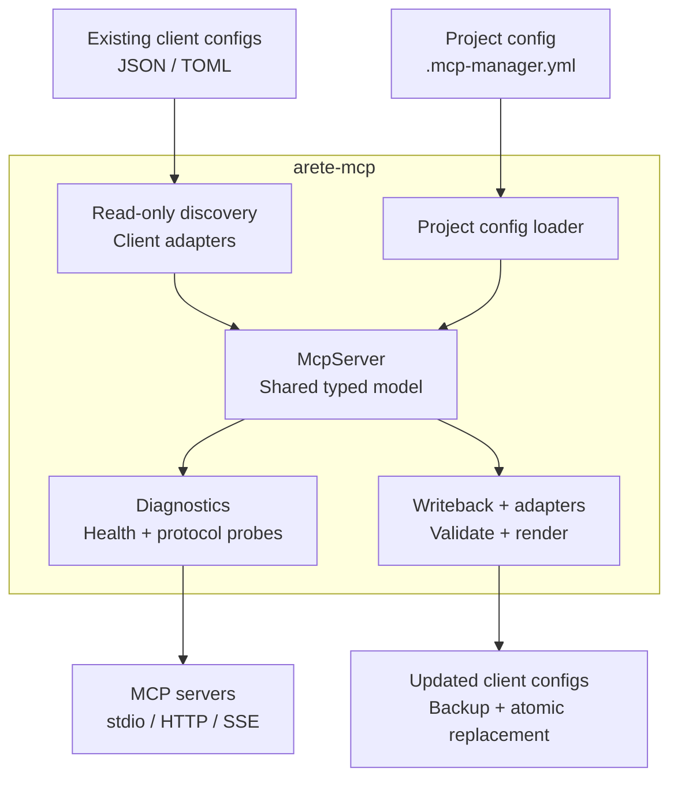

# arete-mcp

**One CLI to discover, diagnose, health-check, and sync MCP servers across Codex, Claude Code, Cursor, Windsurf, and more.**

[](https://github.com/AreteDriver/mcp-manager/actions)
[](https://github.com/AreteDriver/mcp-manager/actions)
[](https://github.com/AreteDriver/mcp-manager/actions)
[](https://python.org)
[](LICENSE)
[](https://pypi.org/project/arete-mcp/)
[](https://pypi.org/project/arete-mcp/)

Think of it as **docker-compose for MCP** — a single `.mcp-manager.yml` in your repo that describes which AI tools your project needs, with one command to sync them to every IDE your team uses.

---

## What this demonstrates

- Translating a fragmented configuration workflow into one documented operating model.
- Safe automation through validation, dry runs, backups, health checks, and rollback-aware writes.
- Practical Python CLI design, cross-tool integration, testing, security guidance, and team onboarding.

## Current status and limitations

This branch is the integrated v1.0.0 release candidate. Publication and real-client acceptance are still pending; installing from PyPI does not install this candidate until the release is published. It manages configuration and diagnostics; it does not host MCP servers or guarantee the behavior of third-party servers and clients. See [Status](#status), [Production Readiness](docs/production-readiness.md), and [Security](SECURITY.md) for the supported contract.

## Why arete-mcp?

The Model Context Protocol (MCP) is the open standard for connecting AI agents to external tools — databases, browsers, filesystems, APIs. But every IDE stores MCP configs differently, and there's no way to share them across a team.

**arete-mcp gives you:**

- **One config file** (`.mcp-manager.yml`) committed with your code
- **One command** to sync it to every IDE (`arete-mcp sync --ide cursor`)
- **Health checks** that verify servers actually work, not just "start"
- **Team onboarding** with `arete-mcp init` — detects IDE, imports servers, scaffolds config

No more manual copy-paste. No more "works on my machine" for AI tool configs.


---

## The Problem

You use Codex, Claude Code, Cursor, and Windsurf. Each stores MCP servers in a different location, scope, or dialect.

```
~/.claude.json
~/.cursor/mcp.json
~/.codeium/windsurf/mcp_config.json
~/.codex/config.toml
```

Your team can't share configs via git. Switching projects means manual copy-paste. One IDE has a server the others don't. You have no idea which servers are actually healthy.

**`arete-mcp` gives you one CLI — and one `.mcp-manager.yml` in your repo — to rule them all.**

---

## 30-Second Quickstart

```bash
# Install
pip install arete-mcp

# See every MCP server across every IDE
arete-mcp list

# See supported targets and diagnose stale paths or missing env vars
arete-mcp targets
arete-mcp doctor

# Check if they actually work (not just "starts")
arete-mcp health --deep

# Scaffold a project config
arete-mcp project init

# Sync it to Cursor (dry-run first, then commit)
arete-mcp sync --ide cursor --dry-run
arete-mcp sync --ide cursor
```

The canonical command is `arete-mcp`. The historical `mcp-manager` command
remains available as a compatibility alias. The existing `.mcp-manager.yml`,
`.mcp-manager.lock`, `MCP_MANAGER_*` environment variables, and
`mcp_manager` Python import namespace are unchanged.

---

## Architecture

`arete-mcp` connects client-specific configuration formats through one typed
[`McpServer` model](src/mcp_manager/models.py). The [CLI](src/mcp_manager/cli.py)
dispatches to [command handlers](src/mcp_manager/commands/), which coordinate the
configuration and diagnostic paths below.



Arrows show the main configuration and diagnostic flows. Parsing and rendering
use the same adapter layer; diagnostics connect to or launch the configured servers.

- **Read:** [`discovery.py`](src/mcp_manager/discovery.py) reads client configs;
  [`project_config.py`](src/mcp_manager/project_config.py) loads project YAML.
  `sync` uses discovered client configs, while `project export` uses `.mcp-manager.yml`.
- **Check:** [`health.py`](src/mcp_manager/health.py) runs transport-specific checks;
  [`compatibility.py`](src/mcp_manager/compatibility.py) probes protocol compatibility
  through the MCP SDK.
- **Write:** [`adapters/`](src/mcp_manager/adapters/) owns client dialects and
  translation capabilities; [`writeback.py`](src/mcp_manager/writeback.py) provides
  previews, backups, and atomic writes for Codex, Claude Code, Claude Desktop,
  Cursor, and Windsurf.

Supporting modules handle [registries](src/mcp_manager/registry_sync.py),
[marketplace installs](src/mcp_manager/marketplace.py),
[authentication](docs/authentication.md), [version locks](src/mcp_manager/lockfile.py),
and [process monitoring](src/mcp_manager/monitor.py).

---
## What Makes This Different

### vs. Manual IDE Config

| | **arete-mcp** | **Manual Config** |
|---|---|---|
| **Share via git** | ✅ `.mcp-manager.yml` committed with code | ❌ Per-IDE JSON scattered in home dirs |
| **Switch projects** | ✅ One command: `arete-mcp sync --ide cursor` | ❌ Manual copy-paste between configs |
| **Team onboarding** | ✅ `arete-mcp init` detects IDE + imports | ❌ Everyone configures manually |
| **Health verification** | ✅ Deep checks: tools/list, deps on PATH | ❌ "Looks like it started" |
| **Rollback** | ✅ Atomic write + backup | ❌ Direct overwrite |
| **CI gate** | ✅ `arete-mcp validate --strict` | ❌ Nothing |

### vs. Other Arete MCPs

| | **arete-mcp** | **Other Managers** |
|---|---|---|
| **Config lives in repo** | ✅ `.mcp-manager.yml` committed with your code | ❌ Global client-native config files |
| **Atomic write-back** | ✅ Backups + dry-run before touching IDE configs | ❌ Direct overwrite, no rollback |
| **Deep health checks** | ✅ Verifies `tools/list` responds, deps on PATH | ❌ "Process started" only |
| **Zero daemon** | ✅ CLI-only, no background services | ❌ Some require persistent gateway/web UI |
| **Python-native** | ✅ `pip install`, works wherever Python 3.11+ does | ❌ Node/Go binaries, extra tooling |
| **Cross-client discovery** | ✅ Reads Codex, Claude, Cursor, Windsurf, and project-scoped configs | ⚠️ Partial coverage |

---

## Features

### 🔍 Discovery
Reads MCP server configs from:
- Claude Code (`~/.claude.json`)
- Claude Desktop (platform-specific user config)
- Cursor (`~/.cursor/mcp.json`)
- Windsurf (`~/.codeium/windsurf/mcp_config.json`)
- Codex (`~/.codex/config.toml`)
- Project-level Claude Code (`.mcp.json`, walks parent dirs)

### 🏥 Health Checks
- **Fast**: Process spawn (stdio) or HTTP ping (SSE) — 10s timeout
- **Deep**: Dependency validation (`node`, `python`, `docker` on PATH) + verify `tools/list` returns non-empty
- **Batch**: Check all servers in parallel with `arete-mcp health`

### 📝 Config Write-Back (Atomic & Safe)
- Writes discovered/merged configs through target-specific JSON or TOML adapters
- **Atomic**: temp file + rename (never corrupts your IDE config)
- **Backups**: `.mcp-manager-backup` created before any modification
- **Dry-run**: Preview changes without touching disk
- **Capability-aware**: rejects unsupported transports and warns about lossy policy/auth translations

### 🏪 Server Marketplace
Discover and install curated MCP servers without hunting through GitHub:

```bash
# Search for servers by name or category
arete-mcp search filesystem
arete-mcp search --category Database

# View details before installing
arete-mcp info postgres

# Add a server to your project config (interactive env var prompts)
arete-mcp install postgres
arete-mcp install slack --no-prompt  # skip prompts, keep ${VAR} placeholders
```

Shipped with 6 official MCP reference servers. Verified servers are shown by default; use `--include-unverified` to browse the full catalog.

### 📁 Project-Scoped Configs
Create `.mcp-manager.yml` in any repo root:

```yaml
project: my-service
servers:
  postgres-local:
    command: node
    args: ["./mcp/postgres-server/dist/index.js"]
    env:
      DATABASE_URL: ${DATABASE_URL}
  stripe-mcp:
    command: npx
    args: ["-y", "@stripe/mcp"]
    env:
      STRIPE_SECRET_KEY: ${STRIPE_SECRET_KEY}
```

- Environment variables (`${VAR}`) resolved at load time
- Validated before write-back (missing env vars or commands caught early)
- Project config wins on merge conflicts with global registry

### 🔐 Version Pinning (Lockfile)
Pin exact MCP server versions for reproducible CI and team consistency:
```bash
arete-mcp lock                    # Resolve and write .mcp-manager.lock
arete-mcp lock --check            # Validate lockfile is current (CI gate)
arete-mcp lock --json             # Output resolved versions as JSON
```

The lockfile records the resolved npm version for each `npx`-based server so every developer and CI runner uses identical tooling.

### 🔄 Export / Import
Portable YAML/JSON for backup, sharing, and CI:
```bash
arete-mcp export servers.yaml
arete-mcp import servers.yaml
```

### 🖥️ Server Monitor (Auto-Restart)
Keep stdio MCP servers alive in development:
```bash
arete-mcp monitor --project .
```
- Watches server processes and restarts on crash
- Exponential backoff (1s → 2s → 4s ... max 30s)
- Graceful shutdown on Ctrl+C / SIGTERM
- JSON status output: `arete-mcp monitor --json`

### 🛡️ MCP Audit (Permission-Prompt Accuracy)
Test whether your IDE's permission prompts faithfully display what MCP tools actually do — the only tool in the ecosystem that tests the **display layer**, not just the protocol layer.

```bash
# List built-in probe specs
arete-mcp audit list

# Generate a markdown runbook for manual verification
arete-mcp audit runbook --output runbook.md

# Start the benign probe MCP server
arete-mcp audit serve
```

Built-in probes cover [HackerOne Category 3](https://hackerone.com/anthropic): tool/parameter misrepresentation in permission prompts. Each probe registers misleading metadata but returns a safe JSON marker — no actual behavior is executed. Supports custom `--probe-spec` YAML files for private threat models.

### 🔒 CI Gate / GitHub Action
Validate `.mcp-manager.yml` on every PR:

```yaml
# .github/workflows/mcp-validate.yml
- uses: AreteDriver/mcp-manager@v1
  with:
    path: "."
    strict: "false"
```

Catches missing env vars, broken commands, and (with `--strict`) failing servers before merge.

---

## Usage

```bash
# List all MCP servers across all IDEs
arete-mcp list

# Filter by IDE
arete-mcp list --tool cursor

# Health check all servers
arete-mcp health

# Probe MCP 2026-07-28 discovery, caching, and legacy fallback
arete-mcp doctor --protocol my-server
arete-mcp doctor --protocol my-server --strict-modern --json

# Deep health check — validate dependencies and verify tools/list
arete-mcp health --deep

# Show server-to-IDE mapping
arete-mcp map

# Search and install from the marketplace
arete-mcp search filesystem
arete-mcp info postgres
arete-mcp install postgres

# Export/import configs (portable YAML/JSON)
arete-mcp export servers.yaml
arete-mcp import servers.yaml

# Add/remove servers from the registry
arete-mcp add my-server --command "node server.js"
arete-mcp remove my-server

# Sync project config to IDE
arete-mcp sync --ide cursor --dry-run
arete-mcp sync --ide cursor
arete-mcp sync --ide codex --dry-run

# Write a client-native project config instead of a user config
arete-mcp sync --ide codex --scope project --project . --create

# Project-level MCP config
arete-mcp project init              # Scaffold .mcp-manager.yml
arete-mcp project validate          # Check env vars, commands on PATH
arete-mcp project export --ide cursor

# Keep stdio servers alive with auto-restart
arete-mcp monitor                   # Foreground monitor, Ctrl+C to stop

# CI gate — validate .mcp-manager.yml in CI
arete-mcp validate                  # Fast validation
arete-mcp validate --strict         # + deep health checks on all servers

# Lockfile — pin exact versions
arete-mcp lock                      # Resolve and write .mcp-manager.lock
arete-mcp lock --check            # Validate lockfile is current (CI gate)

# Permission-prompt security audit
arete-mcp audit list                # Show all built-in audit probes
arete-mcp audit runbook             # Run full permission-prompt audit
arete-mcp audit serve               # Start an MCP server that runs the audit
```

---

## Private Registries & Authentication

Authenticate against private registries so `registry diff` and `registry pull` can fetch server definitions behind HTTP Basic or Bearer auth.

```bash
# Store a Bearer token (validates via HEAD request before saving)
arete-mcp registry login https://reg.example.com/mcp.yaml --token ghp_xxx

# Store Basic auth credentials
arete-mcp registry login https://reg.example.com/mcp.yaml --user alice --password secret

# List stored profiles (credentials are masked)
arete-mcp registry auth-list

# Remove a profile
arete-mcp registry logout https://reg.example.com/mcp.yaml
```

Credentials are stored in `~/.mcp-manager/auth.json` with `0o600` permissions. You can override the path with `MCP_MANAGER_AUTH_FILE`.

**Auth priority chain** (highest wins):
1. CLI flag (`--token`, `--user`)
2. Stored profile for the registry URL
3. Environment variable (`MCP_MANAGER_REGISTRY_TOKEN`, `MCP_MANAGER_REGISTRY_USER` / `PASSWORD`)
4. Anonymous (no auth)

⚠️ **Security note:** passing `--token` on the CLI is insecure — it appears in shell history and `ps` output. Prefer `registry login` (stored credentials) or env vars.

---

## Supported Client Targets

| Target | User Config | Project Config | Format | Write-Back |
|--------|-------------|----------------|--------|------------|
| Codex | `~/.codex/config.toml` | `.codex/config.toml` | TOML | ✅ |
| Claude Code | `~/.claude.json` | `.mcp.json` | JSON | ✅ |
| Claude Desktop | Platform-specific | — | JSON | ✅ |
| Cursor | `~/.cursor/mcp.json` | `.cursor/mcp.json` | JSON | ✅ |
| Windsurf | `~/.codeium/windsurf/mcp_config.json` | — | JSON | ✅ |

Run `arete-mcp targets` for the installed version's exact capability matrix.

---

## Transport Types

- **stdio** — local subprocess, JSON-RPC over stdin/stdout
- **sse** — Server-Sent Events over HTTP
- **http** — HTTP POST JSON-RPC

---

## Status

- [x] Read-only config discovery across 5 client targets
- [x] Async health checks with timeout
- [x] JSON registry with add/remove
- [x] YAML/JSON export/import
- [x] Protocol handshake testing
- [x] Config write-back (atomic, with backups)
- [x] Project-scoped `.mcp-manager.yml` support
- [x] Deep health checks (dependency validation + `tools/list` verification)
- [x] Server auto-restart monitor
- [x] CI gate (`arete-mcp validate` + GitHub Action)
- [x] Version pinning lockfile (`arete-mcp lock --check`)
- [x] Server marketplace / remote registry
- [x] Config inheritance (`extends:`) for shared team configs
- [x] Server tags with `--tag` / `--exclude-tag` filters
- [x] Onboarding wizard (`arete-mcp init`)
- [x] Project templates (`arete-mcp template list` / `use`)
- [x] Private registry authentication (`registry login` / `logout` / `auth-list`)
- [x] MCP permission-prompt accuracy auditing (`arete-mcp audit`)
- [x] Native Codex TOML adapter with policy/auth preservation
- [x] Capability inventory and static target diagnostics (`targets`, `doctor`)
- [x] User/project scoped writes for Codex, Claude Code, and Cursor

See [ROADMAP.md](ROADMAP.md) for what's next.

---

## Contributing

```bash
git clone https://github.com/AreteDriver/mcp-manager.git
cd arete-mcp
python -m venv .venv
source .venv/bin/activate
pip install -e ".[dev]"
```

### Preflight Checklist (required before PR)

```bash
# 1. Linting & formatting
ruff check .
ruff format --check

# 2. Type checking
mypy src/mcp_manager

# 3. Tests with coverage (must be ≥87%)
pytest --cov=mcp_manager --cov-fail-under=87

# 4. Security audit
pip-audit --strict --desc=on .
bandit -r src -ll
```

CI enforces all of the above. PRs that fail any gate will not merge.

---

## Permission Prompt Audit

MCP servers register tools with names and descriptions that appear in permission prompts. A malicious or buggy server can misrepresent what a tool actually does — e.g., register a tool as `"read_file"` that actually executes shell commands.

`arete-mcp audit` tests this display layer with safe, built-in probes:

```bash
# List all built-in probes (HackerOne-style categories)
arete-mcp audit list

# Run the full audit runbook against a target server
arete-mcp audit runbook --target ./my-server

# Start an MCP server that exposes the audit as a tool
arete-mcp audit serve
```

All probes use **benign handlers** — they register misleading metadata but return safe JSON markers. No actual harmful behavior is performed. This makes the audit safe to run against production configs.


---

## Related Projects

- **[animus](https://github.com/AreteDriver/animus)** — Personal AI operating environment with evidence-graded maturity and autonomous improvement
- **[ai-spend](https://github.com/AreteDriver/ai-spend)** — Cross-provider AI cost aggregation (`pip install ai-spend`)
- **[agent-lint](https://github.com/AreteDriver/agent-lint)** — Workflow YAML cost estimator + anti-pattern linter (`pip install agentlinter`)

[Discord](https://discord.gg/fdzQkrt8) — Join the community

*Part of the [AreteDriver](https://github.com/AreteDriver) AI tooling ecosystem.*
